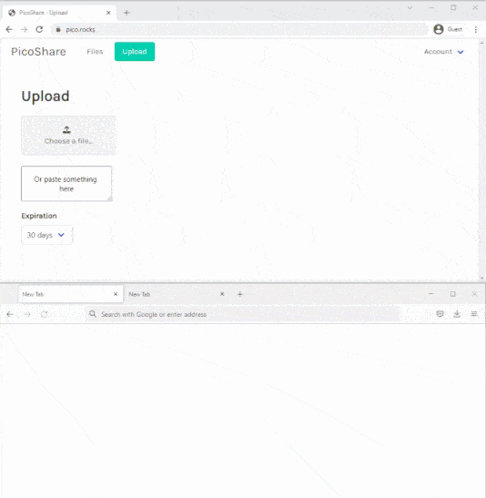

# PicoShare

PicoShare is a minimalist, easy-to-host service for sharing images and other files. Upload a file, get a direct download link, share it with anyone — no ads, no signups for the recipient, no resizing or re-encoding. This repo wraps the pinned upstream release as a one-click Railway template: generated admin passphrase, persistent storage on a Railway volume, and the port wired to Railway automatically.

*Screenshot: upstream demo (from [mtlynch/picoshare](https://github.com/mtlynch/picoshare), `docs/readme-assets/demo.gif`).*

## Source Repository

[https://github.com/INAPP-Mobile/picoshare](https://github.com/INAPP-Mobile/picoshare)

## Deploy and Host

Click **Deploy on Railway** above. The form has one field — `PS_SHARED_SECRET`, pre-filled with a generated passphrase. That is the admin login passphrase: keep it somewhere safe, because it is the only admin credential and PicoShare refuses to start without it. Everything else is automatic: PicoShare listens on Railway's injected `PORT`, and its SQLite database (which holds the files themselves) lives on a persistent volume at `/data`.

After deploy, open the public URL and log in with the passphrase to reach the admin dashboard, where you can see all files, create guest links, and manage settings.

## Why Deploy

- **Direct download links**: every upload gets a short link anyone can open — no account, no ads, no waiting room.
- **Any file, any size**: images, video, audio, documents, archives — PicoShare never forces a file type and never re-encodes your media.
- **Guest links**: create a link and hand it to someone else so they can upload files to you without an account.
- **Private by default**: your files live in your own Railway volume, not on a third-party sharing site. Delete a file and it is gone (space is reclaimed by the nightly garbage collector).
- **Tiny footprint**: a single Go binary with an embedded SQLite database. It idles on a few tens of MB and only works when someone uploads or downloads.

## Common Use Cases

- Sharing screenshots, videos, and documents with friends, clients, or a community without handing them to an ad-supported host.
- A private drop-box: give collaborators a guest link and have them upload files straight to your server.
- Quick file handoff between your own devices — upload from your phone, download on your desktop.
- Hosting images and files you link from a blog, forum, or chat, under your own domain.

## Configuration

One variable on the deploy form:

| Variable | Default | What it does |
|---|---|---|
| `PS_SHARED_SECRET` | `${{secret(16)}}` (generated) | Admin passphrase for logging in. Required — PicoShare will not boot without it (or `PS_SHARED_SECRET_FILE`). |

Baked into the image / handled automatically:

| Variable | Value | What it does |
|---|---|---|
| `PORT` | Railway-injected | TCP port PicoShare listens on (upstream default 4001 when unset). |
| `PS_BEHIND_PROXY` | `true` | Trusts Railway's reverse-proxy headers (`X-Forwarded-Proto` / `X-Forwarded-For`) for correct HTTPS handling and client-IP logging. |

Upstream environment variables you can also set (see [upstream README](https://github.com/mtlynch/picoshare#environment-variables)):

| Variable | Default | What it does |
|---|---|---|
| `PS_SHARED_SECRET_FILE` | — | Path to a file containing the admin passphrase, as an alternative to `PS_SHARED_SECRET`. |
| `LITESTREAM_BUCKET` | — | Litestream-compatible S3 bucket for SQLite replication backups. Unset in this template — the Railway volume is the store. |
| `LITESTREAM_ENDPOINT` | — | S3 endpoint for Litestream replication (e.g. `s3.us-west-002.backblazeb2.com`). |
| `LITESTREAM_ACCESS_KEY_ID` | — | Access key for Litestream replication. |
| `LITESTREAM_SECRET_ACCESS_KEY` | — | Secret key for Litestream replication. |
| `LITESTREAM_PATH` | `db` | Path within the Litestream bucket. |
| `LITESTREAM_RETENTION` | `72h` | How long Litestream snapshots and WAL files are kept. |

PicoShare's only command-line flag is `-db` (path to the SQLite database, default `data/store.db`); this template runs it as `-db /data/store.db` so the database — and the files stored inside it — persist on the Railway volume.

### Deployment Dependencies

- **Plan**: Hobby is plenty — PicoShare is a single small Go binary.
- **RAM**: ~50 MB at rest; uploads stream through without loading whole files into memory.
- **Storage**: one Railway volume mounted at `/data` (the SQLite database holds all files, so volume size is your file budget).
- **Networking**: one public HTTP service; no extra ports, no background workers, no companion database.
- **Upstream**: PicoShare v1.5.4 (`mtlynch/picoshare`), pinned by manifest digest, AGPL-3.0.
