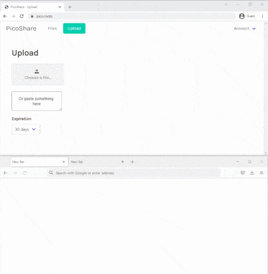

*Screenshot: upstream demo (from [mtlynch/picoshare](https://github.com/mtlynch/picoshare), `docs/readme-assets/demo.gif`).*

# Deploy and Host

PicoShare is a minimalist service for sharing images and other files: upload a file, get a direct download link, share it with anyone. Deploy it on Railway in one click — the form has a single field, a generated admin passphrase. PicoShare listens on Railway's injected `PORT` and stores everything (files included) in a SQLite database on a persistent volume at `/data`.

## About Hosting

This template runs the pinned upstream PicoShare v1.5.4 image (`mtlynch/picoshare`, AGPL-3.0) as a single Go service. There is no companion database and no worker: the SQLite file on the `/data` volume is the whole store, and a nightly garbage collector reclaims space from deleted files. The admin logs in with the generated `PS_SHARED_SECRET` passphrase; guest links let anyone else upload without an account. `PS_BEHIND_PROXY=true` is baked in so HTTPS and client IPs behave correctly behind Railway's edge.

## Why Deploy

- **Direct download links**: every upload gets a short link anyone can open — no account, no ads, no waiting room.
- **Any file, any size**: images, video, audio, documents, archives — PicoShare never forces a file type and never re-encodes your media.
- **Guest links**: hand someone a link and they can upload files to you without an account.
- **Private by default**: your files live in your own Railway volume, not on a third-party sharing site.
- **Tiny footprint**: a single Go binary with embedded SQLite, idling on a few tens of MB.

## Common Use Cases

- Sharing screenshots, videos, and documents with friends, clients, or a community without an ad-supported host.
- A private drop-box: give collaborators a guest link and have them upload files straight to your server.
- Quick file handoff between your own devices — upload from your phone, download on your desktop.
- Hosting images and files you link from a blog, forum, or chat, under your own domain.

## Dependencies for

### Deployment Dependencies

- **Plan**: Hobby is plenty — PicoShare is a single small Go binary.
- **RAM**: ~50 MB at rest; uploads stream through without loading whole files into memory.
- **Storage**: one Railway volume mounted at `/data` (the SQLite database holds all files, so volume size is your file budget).
- **Networking**: one public HTTP service; no extra ports, no background workers, no companion database.
- **Upstream**: PicoShare v1.5.4, pinned by manifest digest, AGPL-3.0.

**Environment variables:** `PS_SHARED_SECRET` (generated admin passphrase, required — the only deploy-form field). Automatic: `PORT` (Railway-injected), `PS_BEHIND_PROXY=true`. Optional upstream extras: `PS_SHARED_SECRET_FILE`, and Litestream replication (`LITESTREAM_BUCKET`, `LITESTREAM_ENDPOINT`, `LITESTREAM_ACCESS_KEY_ID`, `LITESTREAM_SECRET_ACCESS_KEY`, `LITESTREAM_PATH`, `LITESTREAM_RETENTION`) — unset by default; the Railway volume is the store. Full reference in the repo README.
